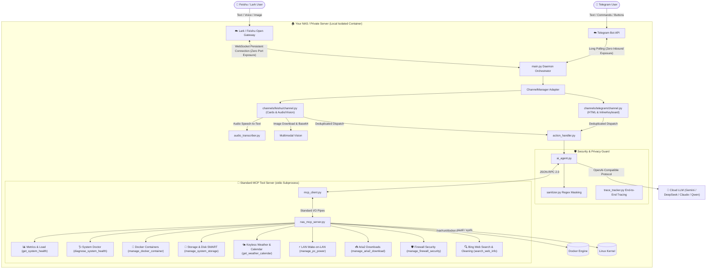

<p align="center">
  
</p>

<h1 align="center">NAS-Agent-Butler</h1>

<p align="center">
  
  
  
  
  
  
  
</p>

<p align="center">
  <b>Ultra-lightweight, Hardware-Agnostic AI Butler Solution for NAS & Linux Private Cloud</b><br>
  No GPU Required · Memory Footprint &lt; 80MB · Zero Public Port Exposure · Telegram &amp; Feishu Dual Channels · Multimodal · Interactive Cards
</p>

<p align="center">
  <b>English</b> | <a href="README_CN.md"><b>简体中文</b></a>
</p>

---

## 💡 Why NAS-Agent-Butler?

Many developers and home lab enthusiasts want a 24/7 intelligent "AI SRE & Life Butler" for their NAS or home servers, but typically face two major roadblocks:
1. **Excessive Hardware Demands**: Running local heavy models (Ollama, 7B/14B models) requires expensive dedicated GPUs or powerful modern CPUs. For low-power Celeron/Gemini Lake chips (J1900, J4125, N5105), Raspberry Pis, old laptops, or 1-vCPU/1GB VPS instances, local inference will crush system performance and RAM.
2. **Insecure Port Exposure**: Traditional webhook bot architectures require a public IP, dynamic DNS, and public port forwarding or reverse proxy setups, leaving your private home network vulnerable to port scans and automated exploits.

**NAS-Agent-Butler is engineered for extreme lightness and uncompromising security:**
- **Zero Local Performance Overhead**: Built on an ultra-lean Python microkernel, it **does not run any heavy models locally**. Runtime memory usage is **under 80MB**, and idle CPU consumption is **near 0%**! All reasoning is handled by ultra-fast, cost-effective cloud model APIs (e.g., Gemini Flash, DeepSeek), allowing low-spec devices to run with zero lag.
- **Bank-Grade Zero-Exposure Security**: Communicates through official WebSocket (Feishu) and Long Polling (Telegram) outbound connections. **No public IP, no router port forwarding, and no SSL certificates required**.
- **Multi-Channel IM Support**: Native out-of-the-box integration with **Telegram Bot** (the #1 standard for overseas HomeLab / NAS users) and **Feishu / Lark**. Both channels provide rich structured cards, inline keyboard action buttons, and mobile toast feedback.
- **Instant Multimodal Interaction**: Send **text**, send **voice messages** (server-side speech-to-text recognition), or send **hardware photos / error screenshots** (multimodal vision understanding). Your butler recognizes requests in seconds and executes operations autonomously.

---

## 💬 Real-world Conversation Demos

### Scenario 1: Comprehensive System Health Inspection

> **User**: How is my NAS doing right now? Are the disks and Docker containers healthy?

```text
┌─────────────────────────────────────────────────────────────────┐
│ 🤖 NAS Smart Butler                          #tr_7a81c2 · Time: 2.3s │
├─────────────────────────────────────────────────────────────────┤
│ 🟢 System is in great health with balanced resource usage:       │
│                                                                 │
│ • CPU Usage: 12% (Load: 0.45, 0.52, 0.48)                       │
│ • Memory Usage: 3.8GB / 16.0GB (23.7%)                          │
│ • CPU Temperature: 42°C (Fan speed: 1250 RPM)                   │
│ • Disk Volumes:                                                 │
│   - / (NVMe SSD): 45% (Healthy, 38°C)                           │
│   - /data (HDD Pool): 68% (All 4 disks SMART PASS)              │
│ • Docker Topology:                                              │
│   - 14/14 containers running healthy (caddy, immich, vaultwarden...) │
│                                                                 │
│ 💡 Recommendation: All services running smoothly. Routine backup │
│    completed 3 hours ago.                                       │
└─────────────────────────────────────────────────────────────────┘
```

<details>
<summary><b>Click to expand more real-world conversation scenarios...</b></summary>

---

### Scenario 2: Container Fault Diagnosis & Auto-Remediation

> **User**: Why is my Immich image backup failing to connect?

```text
┌─────────────────────────────────────────────────────────────────┐
│ 🤖 NAS Smart Butler                          #tr_3b19f0 · Time: 3.1s │
├─────────────────────────────────────────────────────────────────┤
│ 🔍 Diagnosis: Immich Container Cluster Topology Check            │
│                                                                 │
│ • immich_server: 🟢 Running (Up 12 days)                        │
│ • immich_machine_learning: 🟢 Running (Up 12 days)              │
│ • immich_postgres: 🔴 Exited (Exit code: 137 - OOM Killed)       │
│                                                                 │
│ ⚠️ Root Cause: The PostgreSQL database container was killed by   │
│    the host kernel due to Out-Of-Memory during heavy indexing.   │
│                                                                 │
│ [🔄 Restart Postgres Container]   [📊 Inspect Error Logs]         │
└─────────────────────────────────────────────────────────────────┘
```

---

### Scenario 3: LAN Remote Power Management (Wake-on-LAN)

> **User**: Turn on my office PC.

```text
┌─────────────────────────────────────────────────────────────────┐
│ 🤖 NAS Smart Butler                          #tr_9c21a4 · Time: 0.8s │
├─────────────────────────────────────────────────────────────────┤
│ ⚡ LAN Power Management                                          │
│                                                                 │
│ Magic Packet (WOL) successfully broadcast to interface eth0.    │
│ Target MAC: 3C:7C:3F:8A:1B:90                                   │
│ Host status: Initiating boot sequence...                        │
└─────────────────────────────────────────────────────────────────┘
```

---

### Scenario 4: Weather & Living Index Query (Keyless & Privacy-Safe)

> **User**: What's the weather like in Beijing tomorrow? Do I need an umbrella?

```text
┌─────────────────────────────────────────────────────────────────┐
│ 🤖 NAS Smart Butler                          #tr_e518d0 · Time: 1.8s │
├─────────────────────────────────────────────────────────────────┤
│ 🌤️ Beijing Real-Time & Tomorrow Weather Forecast                 │
│                                                                 │
│ • Today: Sunny to cloudy, 21°C ~ 28°C, comfortable humidity.     │
│ • Tomorrow: Scattered showers, precipitation probability 65%,   │
│   temperatures 20°C ~ 25°C.                                     │
│                                                                 │
│ 🌂 Advice: Carry an umbrella tomorrow. A light jacket is        │
│   recommended for cooler evening temperatures.                  │
└─────────────────────────────────────────────────────────────────┘
```

---

### Scenario 5: Warm SRE Morning Briefing & Schedule

> **Scheduled Trigger**: Every morning at 08:00 (customizable), your bot automatically pushes a personalized morning report:  
> Say goodbye to rigid, static templates! The Agent autonomously inspects overnight backup logs, disk SMART metrics, weather, and calendar schedules to generate a fresh, concise, and lively morning card.

</details>

---

## ⚡ Quick Start (3 Steps)

### Step 1: Configure Your IM Channel (Choose at least one)

NAS-Agent-Butler supports **Telegram** and **Feishu / Lark**. Both operate outbound without exposing any inbound ports.

#### Option A: Telegram Bot (Recommended for International / HomeLab Users)

1. Open Telegram, search for [@BotFather](https://t.me/botfather), and send `/newbot`.
2. Follow the instructions to choose a name and username for your bot.
3. `@BotFather` will provide your **Bot Token** (format: `123456789:ABCdefGhIJKlmNoPQRsTUVwxyZ`). Copy it into `.env` as `TELEGRAM_BOT_TOKEN`.
4. *(Optional & Recommended)*:
   - **Automatic Admin Binding**: Leave `TELEGRAM_CHAT_ID` empty in `.env`. When you first start the bot and send `/start`, NAS-Agent-Butler will **automatically memorize and bind your Chat ID**, permanently locking down access against unauthorized users.
   - If your server needs an outbound HTTP/SOCKS5 proxy to connect to Telegram, set `TELEGRAM_PROXY=http://127.0.0.1:7890`.

#### Option B: Feishu / Lark Bot (Recommended for Enterprise / Chinese Users)

1. Log in to the [Feishu Open Platform](https://open.feishu.cn/) (or Lark Developer Console) and create an enterprise custom app.
2. Under "Add Capabilities", enable **"Bot"**.
3. Under "Permissions", grant:
   - `im:message` (Receive and send messages)
   - `im:message.p2p_msg:readonly` (Read 1-on-1 private messages)
   - `im:message:send_as_bot` (Send messages as bot)
   - `im:resource:read` (Download media resources for vision & voice recognition)
4. Under "Events & Callbacks" -> "Event Configuration":
   - Select **"Receive events via persistent connection (WebSocket)"** (**No public IP or callback URL needed!**)
   - Add Event: `im.message.receive_v1` (Receive messages v2.0)
   - Add Callback: `card.action.trigger` (Card button interaction trigger)
5. Under "Credentials & Basic Info", copy your **App ID** and **App Secret**.
6. Under "Version Management & Release", create and publish an application version.

---

### Step 2: Clone Repository & Configure Environment

```bash
# 1. Clone repository
git clone https://github.com/lanzm/NAS-Agent-Butler.git
cd nas-agent-butler-open

# 2. Copy environment template
cp .env.example .env

# 3. Edit .env
nano .env
```

Configure your chosen channel credentials and LLM API:

```ini
# ==========================================
# 1. IM Channel Configuration (Enable at least one)
# ==========================================

# --- Option A: Telegram Bot ---
TELEGRAM_BOT_TOKEN=123456789:ABCdefGhIJKlmNoPQRsTUVwxyZ
# Optional: target chat_id (leave empty for automatic first-user binding)
TELEGRAM_CHAT_ID=
# Optional: HTTP/SOCKS5 proxy (e.g. http://127.0.0.1:7890)
TELEGRAM_PROXY=

# --- Option B: Feishu / Lark Bot ---
FEISHU_APP_ID=cli_xxxxxxxxxxxx
FEISHU_APP_SECRET=xxxxxxxxxxxxxxxxxxxxxxxxxxxxxxxx

# ==========================================
# 2. LLM API Configuration (OpenAI Compatible)
# ==========================================
OPENAI_API_BASE=https://api.openai.com/v1
OPENAI_API_KEY=sk-xxxxxxxxxxxxxxxxxxxxxxxxxxxxxxxx
# Recommended: Fast, cost-efficient multimodal models (e.g. gemini-flash-lite-latest, gemini-2.5-flash, deepseek-chat)
OPENAI_MODEL=gemini-flash-lite-latest

# Default weather city
DEFAULT_CITY=Beijing
```

---

### Step 3: Launch with Docker Compose

Run in the project root directory:

```bash
docker compose up -d
```

Check logs to verify connection status:

```bash
docker compose logs -f
```

When you see:
- For Telegram: `[INFO] Telegram 监听循环已就绪 (Long Polling)...`
- For Feishu: `[INFO] connected to wss://msg-frontier.feishu.cn/ws/v2`

Your butler is live! You can now send `/start` or chat directly with your bot in Telegram or Feishu.

---

### Step 4: One-Click System Doctor Verification (Recommended)

After deployment, run the built-in diagnostic tool to verify all component dependencies and AI Gateway latency in one step:

```bash
docker exec -it feishu-bot python -m app.doctor
```

> 💡 **Everyday Usage**: You can also ask your bot **"Run a system health check"** or send `/start` in Telegram or Feishu at any time. The bot will reply with a color-coded diagnostic card and interactive buttons.

---

## ✨ Core Highlights

| Feature | Description | Value |
| :--- | :--- | :--- |
| **Ultra-Low Resource Footprint** | RAM `< 80MB`, CPU usage `~0%`, no GPU required | Runs 24/7 on Celeron J1900/J4125/N5105, Raspberry Pi, or 1GB VPS without hogging host resources |
| **Dual IM Channels (Telegram & Feishu)** | Native support for Telegram Bot & Feishu/Lark | Perfect for global HomeLab users (Telegram) and enterprise users (Feishu) with unified experience |
| **Financial-Grade Zero Exposure** | Outbound WebSocket (Feishu) & Long Polling (Telegram) | Eliminates public IP, DDNS, and port forwarding; zero attack surface from public port scanners |
| **Full Multimodal Support** | Text, voice speech-to-text, and vision photo diagnostic | Interact anytime via voice messages or snapshot troubleshooting on your phone |
| **Standard MCP Protocol** | Decoupled tool architecture based on Model Context Protocol | Tools run in isolated sub-processes, preventing arbitrary shell injection while allowing plug-and-play extensions |
| **Comprehensive Privacy Sanitization** | Built-in regex data sanitizer (`sanitizer.py`) | Masking API keys, tokens, and local passwords before any telemetry or logs leave the host |
| **Native Interactive Cards & Buttons** | Rich HTML formatting & Inline Keyboard buttons | In-place card patching, quick actions (Status / Docker check), and instant mobile toast notifications |

---

## 🏗️ System Architecture



---

## ⚙️ Environment Variables Reference

| Variable | Default | Description | Required |
| :--- | :--- | :--- | :---: |
| `TELEGRAM_BOT_TOKEN` | None | Telegram Bot token obtained from `@BotFather` | Required if using Telegram |
| `TELEGRAM_CHAT_ID` | Empty | Authorized Telegram chat_id (auto-binds to the first user sending `/start` if empty) | No |
| `TELEGRAM_PROXY` | None | HTTP/SOCKS5 proxy for Telegram API (e.g. `http://127.0.0.1:7890`) | No |
| `FEISHU_APP_ID` | None | Feishu / Lark App ID | Required if using Feishu |
| `FEISHU_APP_SECRET` | None | Feishu / Lark App Secret | Required if using Feishu |
| `OPENAI_API_BASE` | `https://api.openai.com/v1` | LLM API Base URL (Supports third-party gateways) | No |
| `OPENAI_API_KEY` | None | LLM API Key | **Yes** |
| `OPENAI_MODEL` | `gemini-flash-lite-latest` | Model identifier | No |
| `DEFAULT_CITY` | `Beijing` | Default weather query city (Chinese name or Pinyin) | No |
| `DEFAULT_LANGUAGE` | `zh` | Default system language (`zh` for Chinese, `en` for English; auto-responds in English if prompted in English) | No |
| `DAILY_REPORT_TIME` | `08:00` | Scheduled SRE report time (HH:MM) | No |
| `DISK_THRESHOLD` | `90` | Disk usage alert threshold (%) | No |
| `MEM_THRESHOLD` | `90` | Memory usage alert threshold (%) | No |
| `CPU_TEMP_THRESHOLD` | `80` | CPU temperature alert threshold (°C) | No |
| `FEISHU_RECEIVE_ID` | Empty | Default target user open_id for proactive pushes (Feishu) | Recommended for Feishu |
| `ENABLE_PC_POWER` | `false` | Enable PC LAN remote power management (WOL wake/shutdown) | No |
| `TARGET_PC_MAC` | None | Target PC network interface MAC address (e.g. `AA:BB:CC:DD:EE:FF`) | Required if WOL enabled |
| `ARIA2_RPC_URL` | None | Aria2 RPC server endpoint (e.g. `http://127.0.0.1:6800/jsonrpc`) | Required for Aria2 |
| `ARIA2_RPC_SECRET` | None | Aria2 RPC token secret | No |
| `ENABLE_FIREWALL` | `false` | Enable Fail2ban firewall ban status query plugin | No |

---

## ⏰ Declarative Scheduled Tasks (`config/schedules.yaml`)

NAS-Agent-Butler features a prompt-driven declarative scheduler. You can customize scheduled agent tasks in `config/schedules.yaml` without modifying any code:

```yaml
# Daily fixed-time report: Life & SRE briefing
- name: "🌅 Daily SRE & Life Briefing"
  time: "08:00"
  enabled: true
  prompt: |
    Analyze host health metrics, Docker container topology, and today's weather.
    Output a concise, friendly morning briefing under 200 words.
```

---

## 🧩 Extending Your Own MCP Tools

The system adheres strictly to the Model Context Protocol (MCP). To add custom device control or sensors:

1. Open [`app/nas_mcp_server.py`](file:///D:/program/my/nas-agent-butler-open/app/nas_mcp_server.py);
2. Add your JSON Schema tool definition under the `TOOLS` list;
3. Implement the execution branch in `handle_tool_call()`;
4. Restart the container—the LLM will automatically detect and invoke your new tool when needed!

---

## 🛡️ Security Best Practices

1. **Read-Only Mounts**: `docker-compose.yml` mounts `/proc` and `/sys` with `:ro` (read-only) to protect host integrity.
2. **Zero Arbitrary Shell Execution**: The AI does not have access to an unrestricted bash/exec tool; all actions are mediated through typed MCP tools with strict parameters.
3. **Data Sanitization**: All metrics and container logs pass through [`sanitizer.py`](file:///D:/program/my/nas-agent-butler-open/app/sanitizer.py), ensuring credentials and tokens never leave your network.
4. **Anti-Drift Guardrail**: Strict boundary separating local action execution from external information retrieval. Device/hardware operations are restricted strictly to registered local MCP tools. If a device or plugin is not integrated, the bot honestly indicates it rather than hijacking web search to fake execution, preventing context bloat and query timeouts.

---

## 📄 License

This project is licensed under the [MIT License](LICENSE). Contributions, issues, and pull requests are welcome!
