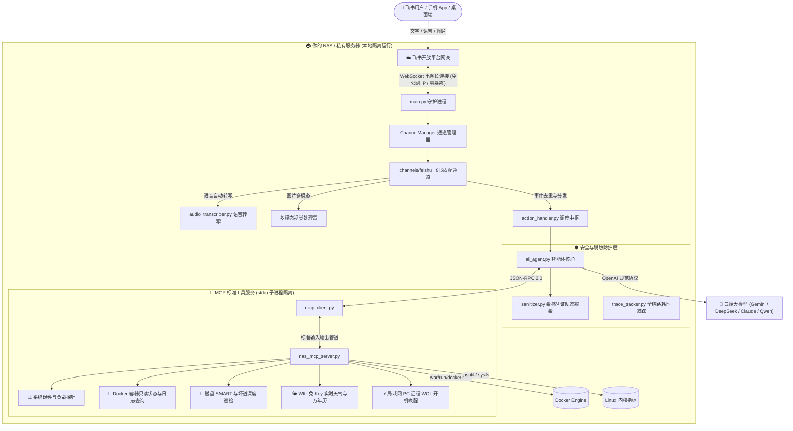

<p align="center">
  
</p>

<h1 align="center">NAS-Agent-Butler</h1>

<p align="center">
  
  
  
  
  
  
</p>

<p align="center">
  <b>极度轻量、不挑配置的 NAS / Linux 私有云智能管家解决方案</b><br>
  无需显卡 · 内存仅占 80MB · 零公网端口暴露 · 支持文本/语音/图片多模态 · 原生高颜值交互卡片
</p>

<p align="center">
  <a href="README.md"><b>简体中文</b></a> | <a href="README_EN.md"><b>English</b></a>
</p>

---

## 💡 为什么做这个项目？

很多开发者和家庭用户希望为自己的 NAS 或私有服务器配备一个 7×24 小时在线的“AI 运维与生活管家”，但常常面临两大痛点：
1. **硬件门槛过高**：本地跑 Ollama、7B/14B 大模型需要昂贵的独立显卡或高性能 CPU，对于 J4125 / N5105、低功耗工控机、闲置旧笔记本或 1核1G 的轻量 VPS 而言，内存和算力根本吃不消。
2. **暴露内网不安全**：许多方案依赖配置 Webhook 公网反向代理，需要公网 IP、动态域名与端口映射，容易引来公网端口扫描与安全隐患。

**NAS-Agent-Butler 专为“轻量与安全”而生：**
- **性能零负担**：纯轻量 Python 微架构，本身**不跑任何本地重型模型**，运行时内存占用 **< 80MB**，待机 CPU 占用 **近乎 0%**！计算全走云端大模型 API（如极速低成本的 Gemini Flash、DeepSeek 等），低配小主机也能丝滑飞起。
- **金融级内网安全**：通过官方 WebSocket 长连接实现双向通信，**无需公网 IP、无需公网端口映射、无需配置 SSL 证书**。
- **多模态即时交互**：客户端发**文字**、发**语音**（自动语音转文字）、甚至发**故障截图/照片**（多模态视觉理解），管家都能秒级识别并执行运维或生活助理操作。

---

## 💬 真实对话效果展示

### 场景 1：日常综合巡检与健康体检

> **用户**：帮我看看 NAS 现在状态怎么样，磁盘和 Docker 正常吗？

```text
┌─────────────────────────────────────────────────────────────────┐
│ 🤖 NAS 家庭智能管家                          #tr_7a81c2 · 耗时 2.3s │
├─────────────────────────────────────────────────────────────────┤
│ 🟢 系统整体健康，各项指标处于平稳水位：                                  │
│                                                                 │
│ 📊 运行概况                                                      │
│ • 主机名：debian-nas (192.168.1.100)                             │
│ • CPU 负载：12% | 温度：46°C                                      │
│ • 内存水位：3.2G / 15.6G (20%)                                   │
│ • 磁盘健康：系统盘 (/) 42% | 存储池 (/mnt/data) 58% (SMART 无坏道) │
│                                                                 │
│ 🐳 容器治理                                                      │
│ • 存活状态：24/24 个容器正在平稳运行                                 │
│ • 核心服务：caddy, jellyfin, vaultwarden, qbittorrent 全部正常    │
│                                                                 │
│ 💡 建议：系统运行状态极佳，暂无需要人工干预的风险项。                      │
└─────────────────────────────────────────────────────────────────┘
```

<details>
<summary><b>👉 点击展开查看更多实战场景（语音交互自愈 / 多模态图片排障 / 天气万年历 / 定时晨报）</b></summary>

<br>

### 场景 2：语音指令交互 & 容器精准自愈

> **用户**：🎤 *[发送一段语音："帮我看看 caddy 的最新日志，然后重启一下它"]*

```text
┌─────────────────────────────────────────────────────────────────┐
│ 🤖 NAS 家庭智能管家                          #tr_9f3b14 · 耗时 3.1s │
├─────────────────────────────────────────────────────────────────┤
│ 🎤 听取语音：“帮我看看 caddy 的最新日志，然后重启一下它”                   │
│                                                                 │
│ 📋 Caddy 运行日志摘要                                            │
│ • 近期日志显示收到来自局域网的正常 HTTPS 反向代理请求，无 fatal 崩溃报错。 │
│                                                                 │
│ 🔄 执行结果                                                      │
│ • 容器 caddy 已平滑重启完毕                                       │
│ • 当前状态：Up 3 seconds (healthy)                               │
└─────────────────────────────────────────────────────────────────┘
```

---

### 场景 3：多模态图片识别与视觉排障

> **用户**：*[发送一张光猫或路由器红色指示灯闪烁的照片 / 或一张系统报错网页截图]*  
> **提问**：帮我看看图里的报错是什么原因，怎么解决？

```text
┌─────────────────────────────────────────────────────────────────┐
│ 🤖 NAS 家庭智能管家                          #tr_c240a1 · 耗时 4.2s │
├─────────────────────────────────────────────────────────────────┤
│ 🖼️ 图片视觉分析结论                                               │
│                                                                 │
│ • 识别结果：检测到路由器 LOS 指示灯处于红灯常亮状态。                 │
│ • 原因诊断：光纤无光信号输入（通常为光纤弯折角度过大、入户尾纤松动或上级机房故障）。 │
│ • 建议操作：                                                     │
│   1. 先检查光猫入户绿色 SC 接口是否插紧；                          │
│   2. 避免光纤过度死弯挤压；                                       │
│   3. 如重新插拔仍常亮红灯，可拨打宽带运营商报修光衰过大。             │
└─────────────────────────────────────────────────────────────────┘
```

---

### 场景 4：免 Key 实时天气与本地万年历

> **用户**：明天周末需要带伞吗？天气如何？

```text
┌─────────────────────────────────────────────────────────────────┐
│ 🤖 NAS 家庭智能管家                          #tr_e518d0 · 耗时 1.8s │
├─────────────────────────────────────────────────────────────────┤
│ 🌤️ 北京 实时与明日天气预报                                       │
│                                                                 │
│ • 今日（农历九月十七 · 寒露）：晴转多云，21°C ~ 28°C，体感舒适。      │
│ • 明日天气：局部有阵雨，降水概率 65%，气温 20°C ~ 25°C。           │
│                                                                 │
│ 🌂 出行建议：明天出门建议随身携带雨具，夜间气温较低建议添一件薄外套。     │
└─────────────────────────────────────────────────────────────────┘
```

---

### 场景 5：晨间定时有温度的 SRE 运维与生活晨报

> **定时触发**：每天早上 08:00（时间可自定义），飞书机器人准时向您推送专属晨报：  
> 彻底摒弃机械僵硬的死板模版，Agent 每日自动巡检昨夜备份日志、磁盘 SMART、天气与节假日日程，生成每天不同、生动精炼的晨报卡片。

</details>

---

## ⚡ 极速上手（3 步完成部署）

### 步骤 1：创建飞书机器人（免公网 IP）

1. 登录 [飞书开放平台](https://open.feishu.cn/)，点击「创建企业自建应用」。
2. 进入「添加应用能力」，添加 **「机器人」** 能力。
3. 进入「权限管理」，搜索并开通以下权限：
   - `im:message`（获取与发送消息）
   - `im:message.p2p_msg:readonly`（读取私聊消息）
   - `im:message:send_as_bot`（以机器人身份发送消息）
   - `im:resource:read`（获取消息中的多模态资源，用于图片识别与语音转文字）
4. 进入「事件与回调」->「事件配置」：
   - 方式选择 **「使用长连接接收事件 (WebSocket)」**（**无需公网 IP 和配置回调域名！**）
   - 添加事件：`im.message.receive_v1`（接收消息 v2.0）
   - 添加卡片回调：`card.action.trigger`（卡片交互触发）
5. 进入「凭证与基础信息」，复制 **App ID** 和 **App Secret**。
6. 进入「版本管理与发布」，创建并发布应用版本。

---

### 步骤 2：下载项目并配置环境变量

```bash
# 1. 克隆代码仓库
git clone https://github.com/your-username/nas-agent-butler.git
cd nas-agent-butler

# 2. 复制配置文件模板
cp .env.example .env

# 3. 编辑 .env
nano .env
```

只需在 `.env` 中填写飞书凭证与你喜欢的大模型 API：

```ini
# --- 飞书配置 ---
FEISHU_APP_ID=cli_xxxxxxxxxxxx
FEISHU_APP_SECRET=xxxxxxxxxxxxxxxxxxxxxxxxxxxxxxxx
# 默认天气查询城市（支持中文，如：北京、上海、广州）
DEFAULT_CITY=北京

# --- 大模型 API (支持任何 OpenAI 兼容规范接口) ---
OPENAI_API_BASE=https://api.openai.com/v1
OPENAI_API_KEY=sk-xxxxxxxxxxxxxxxxxxxxxxxxxxxxxxxx
# 推荐使用高速、低成本且支持视觉多模态的模型 (如 gemini-flash-lite-latest, gemini-2.5-flash, deepseek-chat)
OPENAI_MODEL=gemini-flash-lite-latest
```

---

### 步骤 3：Docker 一键启动

在项目目录下执行：

```bash
docker compose up -d
```

查看日志输出确认连接成功：

```bash
docker compose logs -f
```

当看到 `[INFO] connected to wss://msg-frontier.feishu.cn/ws/v2`，即代表机器人已成功通过长连接接入飞书！现在即可在飞书内向机器人发送文字、语音或图片开始体验。

---

## ✨ 核心特点

| 特性 | 说明 | 带来的价值 |
| :--- | :--- | :--- |
| **超极简硬件开销** | 内存 `< 80MB`，CPU 占用 `~0%`，无显卡要求 | J4125 / N5105 / 树莓派 / 1核1G VPS 均可长期稳定运行，不抢宿主机资源 |
| **无需入站端口** | 飞书 WebSocket 长连接，出网拉取事件 | 默认无需公网 IP 与端口映射；仍需按部署环境配置网络边界 |
| **多模态全支持** | 支持纯文本、语音输入自动转文字、照片/报错截图 Vision 视觉理解 | 手机端随时随地语音对话、拍照问答，交互体验极佳 |
| **MCP 工具架构** | 基于 Model Context Protocol 标准实现工具与大模型解耦 | 工具通过独立子进程调用；Docker API 经受限代理访问，容器重启等写操作默认关闭 |
| **全方位隐私脱敏** | 内置敏感数据脱敏器 (`sanitizer.py`) | 日志或系统数据外发模型前，API 密钥、内网密码、Token 自动掩码过滤 |
| **飞书原生极致交互** | 异步思考跳动动画 + 原地 Patch 无跳动无感刷新 | 卡片排版优美工整，自带 `#tr_xxxx` 全链路诊断 Trace 耗时与 Token 统计 |

---

## 🏗️ 项目架构



---

## ⚙️ 环境变量速查表

| 环境变量名 | 默认值 | 作用说明 | 是否必填 |
| :--- | :--- | :--- | :---: |
| `FEISHU_APP_ID` | 无 | 飞书开放平台 App ID | **是** |
| `FEISHU_APP_SECRET` | 无 | 飞书开放平台 App Secret | **是** |
| `OPENAI_API_BASE` | `https://api.openai.com/v1` | 大模型 API 端点（支持第三方聚合网关） | 否 |
| `OPENAI_API_KEY` | 无 | 大模型 API 密钥 | **是** |
| `OPENAI_MODEL` | `gemini-flash-lite-latest` | 使用的模型标识 | 否 |
| `DEFAULT_CITY` | `北京` | 默认天气查询城市（支持全国市县区中文或拼音） | 否 |
| `DEFAULT_LANGUAGE` | `zh` | 默认系统交互语言 (`zh` 中文, `en` 英文；用户用英文提问时自动英文应答) | 否 |
| `DAILY_REPORT_TIME` | `08:00` | 每日 SRE 运维与生活晨报推送时间 (HH:MM) | 否 |
| `DISK_THRESHOLD` | `90` | 磁盘报警使用率阈值 (%) | 否 |
| `MEM_THRESHOLD` | `90` | 内存报警使用率阈值 (%) | 否 |
| `CPU_TEMP_THRESHOLD` | `80` | CPU 温度报警阈值 (°C) | 否 |
| `FEISHU_RECEIVE_ID` | 空 | 每日定时主动推送目标 open_id (私聊机器人后自动记录绑定) | 建议填入 |

---

## ⏰ 自定义定时与周期 Agent 任务 (`config/schedules.yaml`)

系统内置了声明式的任务调度引擎，支持 **每日定点任务**（`time: "HH:MM"`）与 **高频周期巡检**（`interval_minutes: 分钟`）。全面采用现代化 YAML 规范，完美支持中文注释与原生多行 Prompt，无需编写代码，修改挂载目录下的 `config/schedules.yaml` 即可生效：

```yaml
# 1. 每日定点任务：生活与运维晨报
- name: "🌅 今日 SRE 运维与生活晨报"
  time: "08:00"                # 每日固定触发时间
  enabled: true
  prompt: |
    请先调用 get_weather_calendar 获取今日天气状况、温差、出行建议、农历节气及放假倒计时，
    再综合分析宿主机健康状态、各容器运行状态，并检查常见备份容器（未部署则直接跳过）。
    输出一份精炼专业的晨报，分为【今日生活简报】【系统核心结论】【运行水位】【备份报告】【风险与建议】五段。

# 2. 周期性任务：系统健康静默巡检与 AI 智能诊断
- name: "🔍 系统健康例行巡检与智能诊断"
  interval_minutes: 5          # 巡检间隔（分钟）
  enabled: true
  notify_on_recovery: true     # 故障恢复时自动发送绿色闭环通知（0 Token 消耗）
  thresholds:                  # 告警触发阈值（本地快速比对，未超标时 0 Token 消耗，静默不打扰）
    cpu: 85                    # CPU 使用率百分比
    memory: 90                 # 内存使用率百分比
    disk: 95                   # 磁盘挂载点使用率百分比
    cpu_temp: 80               # CPU 温度（摄氏度）
  prompt: |
    系统检测到指标超标或容器异常。
    请结合当前异常告警项，调用相关工具排查具体原因，给出应急处置建议。
```

---

## 🧩 如何扩展你自己的 MCP 工具？

系统遵循标准的 Model Context Protocol (MCP) 规范。若需要增加你自己的个性化控制能力（例如软路由控制、智能家居联动等）：

1. 打开 [`app/nas_mcp_server.py`](file:///D:/program/my/nas-agent-butler-open/app/nas_mcp_server.py)；
2. 在 `TOOLS` 列表中按照标准 JSON Schema 添加工具定义与使用说明；
3. 在 `handle_tool_call` 函数中增加对应的 Python 执行分支；
4. 重启容器，大模型将自动感知新工具并在合适时机自主调用！

---

## 🛡️ 安全最佳实践

1. **限制 Docker API**：Compose 通过不发布端口的内部网络访问 `docker-socket-proxy`，应用不直接挂载宿主机 Docker socket。代理仅开放容器、镜像和基础信息读取接口（`POST=0`）；Docker socket 的 `:ro` 挂载本身不提供 API 只读权限。
2. **限制工具能力**：不向模型提供通用 `exec` 或 `bash` 工具。容器重启、Fail2ban Docker exec 与 Aria2 新增下载因当前权限边界而禁用；网页抓取仅允许连接经校验的公网目标。
3. **脱敏保护网**：所有流经 AI 的指标、容器日志与输出内容均经过 [`sanitizer.py`](file:///D:/program/my/nas-agent-butler-open/app/sanitizer.py) 正则脱敏过滤，密码与 Key 不会离开内网。

---

## 📄 开源许可证

本项目基于 [MIT 许可证](LICENSE) 开源，欢迎提交 Issue 或 Pull Request！
