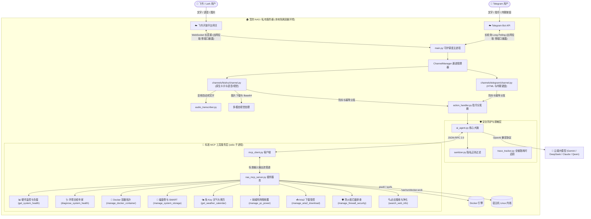

<p align="center">
  
</p>

<h1 align="center">NAS-Agent-Butler</h1>

<p align="center">
  
  
  
  
  
  
  
</p>

<p align="center">
  <b>极度轻量、不挑配置的 NAS / Linux 私有云智能管家解决方案</b><br>
  无需显卡 · 内存仅占 80MB · 零公网端口暴露 · Telegram / 飞书双通道 · 多模态交互 · 原生富文本卡片与内联按钮
</p>

<p align="center">
  <a href="README.md"><b>English</b></a> | <b>简体中文</b>
</p>

---

## 💡 为什么做这个项目？

很多开发者和家庭用户希望为自己的 NAS 或私有服务器配备一个 7×24 小时在线的“AI 运维与生活管家”，但常常面临两大痛点：
1. **硬件门槛过高**：本地跑 Ollama、7B/14B 大模型需要昂贵的独立显卡或高性能 CPU，对于 J4125 / N5105、低功耗工控机、闲置旧笔记本或 1核1G 的轻量 VPS 而言，内存和算力根本吃不消。
2. **暴露内网不安全**：许多方案依赖配置 Webhook 公网反向代理，需要公网 IP、动态域名与端口映射，容易引来公网端口扫描与安全隐患。

**NAS-Agent-Butler 专为“极简轻量、安全与普适”而生：**
- **性能零负担**：纯轻量 Python 微架构，本身**不跑任何本地重型模型**，运行时内存占用 **< 80MB**，待机 CPU 占用 **近乎 0%**！计算全走云端大模型 API（如极速低成本的 Gemini Flash、DeepSeek 等），低配小主机也能丝滑飞起。
- **金融级内网安全**：通过官方长轮询（Telegram Long Polling）或长连接（飞书 WebSocket）实现主动出网双向通信，**无需公网 IP、无需公网端口映射、无需配置反向代理与 SSL 证书**。
- **Telegram / 飞书多通道原生支持**：既支持国际最主流的 **Telegram Bot**（原生 HTML 排版、内联键盘按钮 Inline Keyboard、移动端 Toast 实时反馈），也深度集成**飞书 (Lark)**。统一适配器架构，自由选用。
- **多模态即时交互**：客户端发**文字**、发**语音**（自动语音转文字）、甚至发**故障截图/照片**（多模态视觉理解），管家都能秒级识别并执行运维或生活助理操作。

---

## 💬 真实对话效果展示

### 场景 1：日常综合巡检与健康体检

> **用户**：帮我看看 NAS 现在状态怎么样，磁盘和 Docker 正常吗？

```text
┌─────────────────────────────────────────────────────────────────┐
│ 🤖 NAS 家庭智能管家                          #tr_7a81c2 · 耗时 2.3s │
├─────────────────────────────────────────────────────────────────┤
│ 🟢 系统整体健康，各项指标处于平稳水位：                                  │
│                                                                 │
│ • CPU 占用率: 12% (负载: 0.45, 0.52, 0.48)                       │
│ • 内存占用率: 3.8GB / 16.0GB (23.7%)                             │
│ • CPU 核心温度: 42°C (风扇转速: 1250 RPM)                         │
│ • 磁盘卷状态:                                                    │
│   - / (系统固态 NVMe): 45% (健康度良好，38°C)                       │
│   - /data (机械阵列 Pool): 68% (全部 4 块硬盘 SMART PASS)         │
│ • Docker 容器拓扑:                                               │
│   - 14/14 个容器健康运行中 (caddy, immich, vaultwarden...)       │
│                                                                 │
│ 💡 运维建议：宿主机负载极轻，各项服务运行正常，无积压报警。              │
└─────────────────────────────────────────────────────────────────┘
```

<details>
<summary><b>点击展开查看更多真实对话场景...</b></summary>

---

### 场景 2：容器故障定位与自动化自愈排查

> **用户**：我的相册备份好像连不上了，帮我看看 Immich 怎么了？

```text
┌─────────────────────────────────────────────────────────────────┐
│ 🤖 NAS 家庭智能管家                          #tr_3b19f0 · 耗时 3.1s │
├─────────────────────────────────────────────────────────────────┤
│ 🔍 诊断结果：Immich 容器集群状态排查                             │
│                                                                 │
│ • immich_server: 🟢 运行中 (Up 12 days)                          │
│ • immich_machine_learning: 🟢 运行中 (Up 12 days)                │
│ • immich_postgres: 🔴 已异常退出 (Exit Code: 137 - OOM Killed)    │
│                                                                 │
│ ⚠️ 根因分析：数据库容器由于宿主机内存瞬时高峰被系统 OOM 强行杀掉。   │
│                                                                 │
│ [🔄 重启 Postgres 容器]   [📊 查看最后报错日志]                   │
└─────────────────────────────────────────────────────────────────┘
```

---

### 场景 3：局域网远程开机（Wake-on-LAN）

> **用户**：帮我把书房的台式电脑开机。

```text
┌─────────────────────────────────────────────────────────────────┐
│ 🤖 NAS 家庭智能管家                          #tr_9c21a4 · 耗时 0.8s │
├─────────────────────────────────────────────────────────────────┤
│ ⚡ 局域网电源管理                                                │
│                                                                 │
│ 魔术唤醒包 (WOL) 已成功广播至网络接口 eth0。                     │
│ 目标 MAC 地址: 3C:7C:3F:8A:1B:90                                 │
│ 目标主机状态: 正在唤醒引导开机...                                │
└─────────────────────────────────────────────────────────────────┘
```

---

### 场景 4：免 Key 天气与穿衣指数（零第三方 API Key 依赖）

> **用户**：明天北京天气怎么样？出门需要带伞吗？

```text
┌─────────────────────────────────────────────────────────────────┐
│ 🤖 NAS 家庭智能管家                          #tr_e518d0 · 耗时 1.8s │
├─────────────────────────────────────────────────────────────────┤
│ 🌤️ 北京市 明日天气早报与生活出行指南                              │
│                                                                 │
│ • 今日实况: 多云转阴，21°C ~ 28°C，体感舒适。                      │
│ • 明日天气: 局部阵雨，降雨概率 65%，气温 20°C ~ 25°C。            │
│                                                                 │
│ 🌂 生活建议: 明日有阵雨风险，出门请务必随身携带雨伞；晚间气温适度  │
│    转凉，建议披一件薄外套。                                      │
└─────────────────────────────────────────────────────────────────┘
```

---

### 场景 5：晨间全自动生活与 SRE 智能晨报

> **定时触发**：每天早晨 08:00（时间可自由设定），机器人自动推送晨报：  
> 告别死板的固定模板，Agent 会根据昨夜备份情况、磁盘健康、当日天气以及日程规划，自动提炼并组织成一段有温度、有干货的智能晨间播报卡片。

</details>

---

## ⚡ 极速上手（3 步完成部署）

### 步骤 1：配置交互通道（支持 Telegram 与飞书，二选一或同时开启）

NAS-Agent-Butler 采用出网拉取机制，无论选用哪种通道，**均无需公网 IP 与路由端口映射**。

#### 选项 A：Telegram 机器人（推荐海外 / HomeLab 玩家）

1. 在 Telegram 中搜索关注 [@BotFather](https://t.me/botfather)，发送 `/newbot` 指令；
2. 按照提示输入机器人名称与用户名，BotFather 会生成一段 **Bot Token**（格式如 `123456789:ABCdefGhIJKlmNoPQRsTUVwxyZ`）；
3. 复制 Token 并填入 `.env` 中的 `TELEGRAM_BOT_TOKEN` 项；
4. *(可选且推荐)*：
   - **自动绑定管理员**：保持 `TELEGRAM_CHAT_ID` 为空。首次启动容器后，直接向机器人发送 `/start`，管家将**全自动记忆并绑定您的 Chat ID**，后续自动拦截所有未授权用户的指令！
   - 若 NAS 服务器处于受限网络需要通过本地代理出网，配置 `TELEGRAM_PROXY=http://127.0.0.1:7890` 即可。

#### 选项 B：飞书企业自建应用（推荐国内用户 / 团队协作）

1. 登录 [飞书开放平台](https://open.feishu.cn/)，点击「创建企业自建应用」；
2. 进入「添加应用能力」，添加 **「机器人」** 能力；
3. 进入「权限管理」，搜索并开通以下权限：
   - `im:message`（获取与发送消息）
   - `im:message.p2p_msg:readonly`（读取私聊消息）
   - `im:message:send_as_bot`（以机器人身份发送消息）
   - `im:resource:read`（获取多模态资源，用于图片识别与语音转文字）
4. 进入「事件与回调」->「事件配置」：
   - 方式选择 **「使用长连接接收事件 (WebSocket)」**（**免公网 IP，免配置域名**）
   - 添加事件：`im.message.receive_v1`（接收消息 v2.0）
   - 添加卡片回调：`card.action.trigger`（卡片交互触发）
5. 进入「凭证与基础信息」，复制 **App ID** 和 **App Secret**；
6. 进入「版本管理与发布」，创建并发布应用版本。

---

### 步骤 2：下载项目并配置环境变量

```bash
# 1. 克隆代码仓库
git clone https://github.com/lanzm/NAS-Agent-Butler.git
cd nas-agent-butler-open

# 2. 复制配置文件模板
cp .env.example .env

# 3. 编辑 .env
nano .env
```

只需在 `.env` 中填写所选通道的凭证与大模型 API：

```ini
# ==========================================
# 1. 通道接入配置 (至少启用一种通道)
# ==========================================

# --- 选项 A: Telegram Bot ---
TELEGRAM_BOT_TOKEN=123456789:ABCdefGhIJKlmNoPQRsTUVwxyZ
# 可选: 管理员 chat_id (留空则在首次发送 /start 时自动安全绑定)
TELEGRAM_CHAT_ID=
# 可选: HTTP/SOCKS5 出网代理 (如 http://127.0.0.1:7890)
TELEGRAM_PROXY=

# --- 选项 B: 飞书应用 ---
FEISHU_APP_ID=cli_xxxxxxxxxxxx
FEISHU_APP_SECRET=xxxxxxxxxxxxxxxxxxxxxxxxxxxxxxxx

# ==========================================
# 2. 大模型 API (支持任何 OpenAI 兼容规范接口)
# ==========================================
OPENAI_API_BASE=https://api.openai.com/v1
OPENAI_API_KEY=sk-xxxxxxxxxxxxxxxxxxxxxxxxxxxxxxxx
# 推荐使用高速、低成本且支持视觉多模态的模型 (如 gemini-flash-lite-latest, gemini-2.5-flash, deepseek-chat)
OPENAI_MODEL=gemini-flash-lite-latest

# 默认天气查询城市
DEFAULT_CITY=北京
```

---

### 步骤 3：Docker 一键启动

在项目根目录下执行：

```bash
docker compose up -d
```

查看日志确认接入成功：

```bash
docker compose logs -f
```

当看到以下任意连接就绪日志时：
- Telegram 端：`[INFO] Telegram 监听循环已就绪 (Long Polling)...`
- 飞书端：`[INFO] connected to wss://msg-frontier.feishu.cn/ws/v2`

即代表管家已成功接入！现在即可在客户端直接向机器人发送 `/start` 或任意文本、语音、图片开始体验。

---

### 步骤 4：一键环境体检（System Doctor · 推荐）

部署完成后，推荐在容器内执行自检工具，一键校验所有核心依赖连通性与模型网关延迟：

```bash
docker exec -it feishu-bot python -m app.doctor
```

> 💡 **日常使用**：日常在 Telegram 或飞书聊天框中，也可直接向机器人发送 **“/start”**、**“体检一下系统环境”** 或 **“做个自检”**，管家将通过 MCP 工具输出排版优美、带耗时评级与红绿灯状态的专属体检卡片。

---

## ✨ 核心特点

| 特性 | 说明 | 带来的价值 |
| :--- | :--- | :--- |
| **超极简硬件开销** | 内存 `< 80MB`，CPU 占用 `~0%`，无显卡要求 | J4125 / N5105 / 树莓派 / 1核1G VPS 均可长期稳定运行，不抢宿主机资源 |
| **Telegram / 飞书双通道** | 原生支持 Telegram Bot 与飞书 / Lark | 无论是海外 HomeLab / VPS 用户还是国内桌面办公用户，均可无缝契合 |
| **无需公网入站端口** | Telegram Long Polling 与飞书 WebSocket 长连接 | 彻底告别公网 IP、DDNS 动态域名与路由器端口映射，消弭外部扫描威胁 |
| **多模态全支持** | 支持纯文本、语音输入自动转文字、照片/报错截图 Vision 视觉理解 | 手机端随时随地语音对话、拍照问答，交互体验极佳 |
| **标准 MCP 协议** | 基于 Model Context Protocol 规范的解耦架构 | 插件以独立子进程沙箱执行，杜绝 LLM 任意执行危险 Shell 命令，扩展即插即用 |
| **全方位隐私脱敏** | 内置高精度正则脱敏引擎 (`sanitizer.py`) | 敏感 Token、密码、接口密钥出网前自动打码脱敏，杜绝私有数据泄露 |
| **原生富文本卡片与内联按钮** | Telegram 原生 HTML 渲染 + 内联键盘按钮 (Inline Keyboard) | 原地动态刷新卡片状态，点击按钮即时响应移动端 Toast 提示气泡 |

---

## 🏗️ 系统架构



---

## ⚙️ 环境变量全量参考表

| 变量名 | 默认值 | 说明 | 是否必填 |
| :--- | :--- | :--- | :---: |
| `TELEGRAM_BOT_TOKEN` | 无 | Telegram Bot Token（由 `@BotFather` 获取） | 使用 Telegram 时必填 |
| `TELEGRAM_CHAT_ID` | 空 | 授权管理员 Chat ID（留空则在首次发送 `/start` 时自动安全绑定） | 否 |
| `TELEGRAM_PROXY` | 无 | Telegram API 专用 HTTP/SOCKS5 出网代理（如 `http://127.0.0.1:7890`） | 否 |
| `FEISHU_APP_ID` | 无 | 飞书开放平台应用 App ID | 使用飞书时必填 |
| `FEISHU_APP_SECRET` | 无 | 飞书开放平台应用 App Secret | 使用飞书时必填 |
| `OPENAI_API_BASE` | `https://api.openai.com/v1` | 大模型 API Base URL（支持各大中转商与云平台） | 否 |
| `OPENAI_API_KEY` | 无 | 大模型 API Key | **必填** |
| `OPENAI_MODEL` | `gemini-flash-lite-latest` | 调用的模型型号代号 | 否 |
| `DEFAULT_CITY` | `北京` | 天气默认查询城市（支持中文或拼音） | 否 |
| `DEFAULT_LANGUAGE` | `zh` | 系统默认语言（`zh` 为中文，`en` 为英文；用户以英文提问时自动英文回复） | 否 |
| `DAILY_REPORT_TIME` | `08:00` | 每日定时晨报推送时间 (HH:MM) | 否 |
| `DISK_THRESHOLD` | `90` | 磁盘空间占用报警阈值 (%) | 否 |
| `MEM_THRESHOLD` | `90` | 内存占用报警阈值 (%) | 否 |
| `CPU_TEMP_THRESHOLD` | `80` | CPU 核心温度报警阈值 (°C) | 否 |
| `FEISHU_RECEIVE_ID` | 空 | 飞书专属：主动广播推送目标用户 open_id | 飞书通道推荐配置 |
| `ENABLE_PC_POWER` | `false` | 是否开启 PC 远程电源控制功能 (WOL 唤醒/关机) | 否 |
| `TARGET_PC_MAC` | 无 | 目标开机 PC 的网卡物理 MAC 地址 (如 `AA:BB:CC:DD:EE:FF`) | 启用 WOL 时必填 |
| `ARIA2_RPC_URL` | 无 | Aria2 RPC 服务地址 (如 `http://127.0.0.1:6800/jsonrpc`) | 接入 Aria2 时必填 |
| `ARIA2_RPC_SECRET` | 无 | Aria2 RPC 访问密钥 Token | 否 |
| `ENABLE_FIREWALL` | `false` | 是否开启 Fail2ban 防火墙封禁状态检测插件 | 否 |

---

## ⏰ 声明式定时任务配置 (`config/schedules.yaml`)

NAS-Agent-Butler 具备提示词驱动的声明式定时引擎。你可以直接在 `config/schedules.yaml` 中增改定时任务，无需编写一行代码：

```yaml
# 每日定点任务：生活与运维晨报
- name: "🌅 今日 SRE 运维与生活晨报"
  time: "08:00"
  enabled: true
  prompt: |
    综合检查主机健康状况、Docker 容器拓扑与今日天气，
    输出一份亲切、言简意赅的晨报（200字以内）。
```

---

## 🧩 如何扩展自研 MCP 工具

系统严格遵循 Anthropic 主导的 **Model Context Protocol (MCP)** 规范。添加私有设备或传感器操作极其便捷：

1. 打开 [`app/nas_mcp_server.py`](file:///D:/program/my/nas-agent-butler-open/app/nas_mcp_server.py)；
2. 在 `TOOLS` 列表中追加你的工具 JSON Schema 参数定义；
3. 在 `handle_tool_call()` 路由分支中编写执行逻辑；
4. 重启容器——大模型即可全自动识别并在合适语境下调用你的专属工具！

---

## 🛡️ 安全合规与生产实践

1. **只读挂载保护**：`docker-compose.yml` 默认以 `:ro` (只读) 挂载 `/proc` 与 `/sys`，避免任何意外写入破坏宿主机；
2. **拒绝盲目执行 Shell**：AI 不具备全局无限制 bash/exec 执行权限，必须通过强类型的 MCP 预置工具受控执行；
3. **隐私脱敏防泄漏**：宿主机指标与容器日志经过 [`sanitizer.py`](file:///D:/program/my/nas-agent-butler-open/app/sanitizer.py) 正则脱敏过滤后方可发往云端模型；
4. **防漂移边界隔离**：明确本地执行与外部检索边界，未接入的本地硬件直接如实告知，严禁通过联网搜索伪造执行结果，避免上下文污染。

---

## 📄 开源许可证

本项目基于 [MIT 许可证](LICENSE) 开源。欢迎提交 Issue 与 Pull Request！
