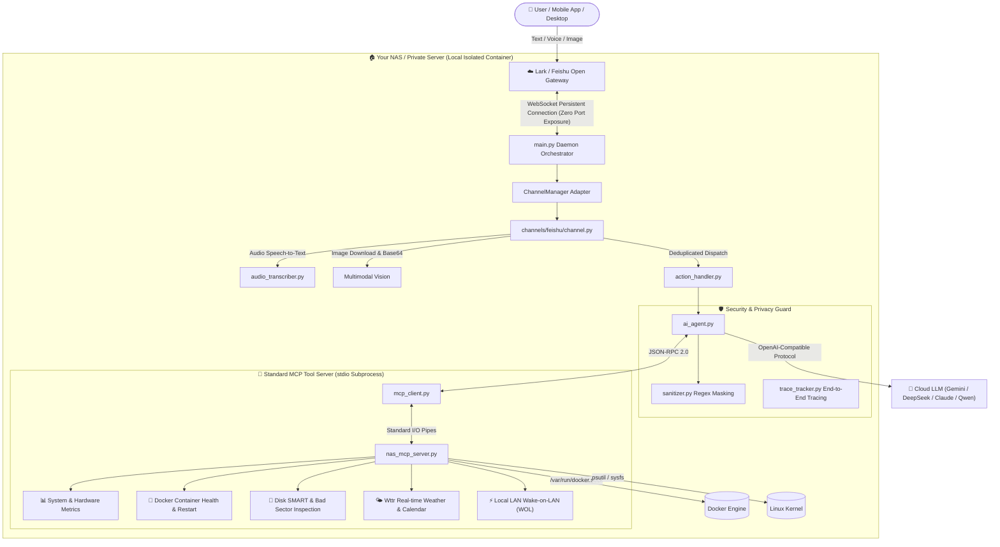

<p align="center">
  
</p>

<h1 align="center">NAS-Agent-Butler</h1>

<p align="center">
  
  
  
  
  
  
</p>

<p align="center">
  <b>Ultra-lightweight, Hardware-Agnostic AI Butler Solution for NAS & Linux Private Cloud</b><br>
  No GPU Required · Memory Footprint &lt; 80MB · Zero Public Port Exposure · Multimodal (Text / Voice / Vision) · Native Interactive Cards
</p>

<p align="center">
  <a href="README.md"><b>简体中文</b></a> | <a href="README_EN.md"><b>English</b></a>
</p>

---

## 💡 Why NAS-Agent-Butler?

Many developers and home lab enthusiasts want a 24/7 intelligent "AI SRE & Life Butler" for their NAS or home servers, but typically face two major roadblocks:
1. **Excessive Hardware Demands**: Running local heavy models (Ollama, 7B/14B models) requires expensive dedicated GPUs or powerful modern CPUs. For low-power Celeron/Gemini Lake chips (J1900, J4125, N5105), Raspberry Pis, old laptops, or 1-vCPU/1GB VPS instances, local inference will crush system performance and RAM.
2. **Insecure Port Exposure**: Traditional webhook bot architectures require a public IP, dynamic DNS, and public port forwarding or reverse proxy setups, leaving your private home network vulnerable to port scans and automated exploits.

**NAS-Agent-Butler is engineered for extreme lightness and uncompromising security:**
- **Zero Local Performance Overhead**: Built on an ultra-lean Python microkernel, it **does not run any heavy models locally**. Runtime memory usage is **under 80MB**, and idle CPU consumption is **near 0%**! All reasoning is handled by ultra-fast, cost-effective cloud model APIs (e.g., Gemini Flash, DeepSeek), allowing low-spec devices to run with zero lag.
- **Bank-Grade Zero-Exposure Security**: Communicates through official WebSocket outbound persistent connections. **No public IP, no router port forwarding, and no SSL certificates required**.
- **Instant Multimodal Interaction**: Send **text**, send **voice messages** (server-side speech-to-text recognition), or send **hardware photos / error screenshots** (multimodal vision understanding). Your butler recognizes requests in seconds and executes operations autonomously.

---

## 💬 Real-world Conversation Demos

### Scenario 1: Comprehensive System Health Inspection

> **User**: How is my NAS doing right now? Are the disks and Docker containers healthy?

```text
┌─────────────────────────────────────────────────────────────────┐
│ 🤖 NAS Smart Butler                          #tr_7a81c2 · Time: 2.3s │
├─────────────────────────────────────────────────────────────────┤
│ 🟢 System is in great health with balanced resource usage:       │
│                                                                 │
│ 📊 Overview                                                     │
│ • Hostname: debian-nas (192.168.1.100)                          │
│ • CPU Load: 12% | Temp: 46°C                                    │
│ • Memory Watermark: 3.2G / 15.6G (20%)                          │
│ • Disk Health: Root (/) 42% | Storage (/mnt/data) 58% (SMART OK)│
│                                                                 │
│ 🐳 Containers                                                   │
│ • Running: 24/24 containers running smoothly                    │
│ • Core Services: caddy, jellyfin, vaultwarden, qbittorrent [OK] │
│                                                                 │
│ 💡 Suggestion: All systems operating smoothly. No action needed.│
└─────────────────────────────────────────────────────────────────┘
```

<details>
<summary><b>👉 Click to expand more real-world scenarios (Voice Self-Healing / Vision Diagnostics / Weather & Calendar / SRE Morning Briefing)</b></summary>

<br>

### Scenario 2: Voice Command & Container Healing

> **User**: 🎤 *[Voice message: "Check the latest logs of caddy and restart it for me"]*

```text
┌─────────────────────────────────────────────────────────────────┐
│ 🤖 NAS Smart Butler                          #tr_9f3b14 · Time: 3.1s │
├─────────────────────────────────────────────────────────────────┤
│ 🎤 Voice Transcription: "Check the latest logs of caddy and restart it for me" │
│                                                                 │
│ 📋 Caddy Log Summary                                            │
│ • Recent logs indicate normal HTTPS reverse-proxy traffic; no crashes. │
│                                                                 │
│ 🔄 Execution Result                                             │
│ • Container caddy has been restarted smoothly                   │
│ • Current Status: Up 3 seconds (healthy)                        │
└─────────────────────────────────────────────────────────────────┘
```

---

### Scenario 3: Multimodal Vision & Hardware Troubleshooting

> **User**: *[Sends a photo of a blinking red router/fiber modem LED or a webpage error screenshot]*  
> **Prompt**: Can you tell me what this error light means and how to fix it?

```text
┌─────────────────────────────────────────────────────────────────┐
│ 🤖 NAS Smart Butler                          #tr_c240a1 · Time: 4.2s │
├─────────────────────────────────────────────────────────────────┤
│ 🖼️ Vision Diagnostic Analysis                                   │
│                                                                 │
│ • Observation: The modem's LOS indicator is solid RED.          │
│ • Root Cause: Optical signal loss (bent fiber cable, loose green│
│   SC connector, or ISP node outage).                            │
│ • Recommended Action:                                           │
│   1. Check if the green optical cable connector is firmly plugged; │
│   2. Ensure the optical fiber cable is not sharply bent;        │
│   3. If red light persists, contact your ISP to check line loss.│
└─────────────────────────────────────────────────────────────────┘
```

---

### Scenario 4: Keyless Real-time Weather & Calendar

> **User**: Do I need to bring an umbrella this weekend? How's the weather?

```text
┌─────────────────────────────────────────────────────────────────┐
│ 🤖 NAS Smart Butler                          #tr_e518d0 · Time: 1.8s │
├─────────────────────────────────────────────────────────────────┤
│ 🌤️ Beijing Real-Time & Tomorrow Weather Forecast                 │
│                                                                 │
│ • Today: Sunny to cloudy, 21°C ~ 28°C, comfortable humidity.     │
│ • Tomorrow: Scattered showers, precipitation probability 65%,   │
│   temperatures 20°C ~ 25°C.                                     │
│                                                                 │
│ 🌂 Advice: Carry an umbrella tomorrow. A light jacket is        │
│   recommended for cooler evening temperatures.                  │
└─────────────────────────────────────────────────────────────────┘
```

---

### Scenario 5: Warm SRE Morning Briefing & Schedule

> **Scheduled Trigger**: Every morning at 08:00 (customizable), your bot automatically pushes a personalized morning report:  
> Say goodbye to rigid, static templates! The Agent autonomously inspects overnight backup logs, disk SMART metrics, weather, and calendar schedules to generate a fresh, concise, and lively morning card.

</details>

---

## ⚡ Quick Start (3 Steps)

### Step 1: Create a Feishu / Lark Bot (Zero Port Exposure)

1. Log in to the [Feishu Open Platform](https://open.feishu.cn/) (or Lark Developer Console) and create an enterprise custom application.
2. Under "Add Capabilities", enable **"Bot"**.
3. Under "Permissions", search and grant:
   - `im:message` (Receive and send messages)
   - `im:message.p2p_msg:readonly` (Read 1-on-1 private messages)
   - `im:message:send_as_bot` (Send messages as bot)
   - `im:resource:read` (Download media resources for vision & voice recognition)
4. Under "Events & Callbacks" -> "Event Configuration":
   - Select **"Receive events via persistent connection (WebSocket)"** (**No public IP or callback URL needed!**)
   - Add Event: `im.message.receive_v1` (Receive messages v2.0)
   - Add Callback: `card.action.trigger` (Card button interaction trigger)
5. Under "Credentials & Basic Info", copy your **App ID** and **App Secret**.
6. Under "Version Management & Release", create and publish an application version.

---

### Step 2: Clone Repository & Configure Environment

```bash
# 1. Clone repository
git clone https://github.com/your-username/nas-agent-butler.git
cd nas-agent-butler

# 2. Copy environment template
cp .env.example .env

# 3. Edit .env
nano .env
```

Fill in your bot credentials and preferred LLM API:

```ini
# --- Feishu / Lark Credentials ---
FEISHU_APP_ID=cli_xxxxxxxxxxxx
FEISHU_APP_SECRET=xxxxxxxxxxxxxxxxxxxxxxxxxxxxxxxx
# Default weather city
DEFAULT_CITY=Beijing

# --- LLM API Configuration (OpenAI Compatible) ---
OPENAI_API_BASE=https://api.openai.com/v1
OPENAI_API_KEY=sk-xxxxxxxxxxxxxxxxxxxxxxxxxxxxxxxx
# Recommended: Fast, cost-efficient multimodal models (e.g. gemini-flash-lite-latest, gemini-2.5-flash, deepseek-chat)
OPENAI_MODEL=gemini-flash-lite-latest
```

---

### Step 3: Launch with Docker Compose

Run in the project root directory:

```bash
docker compose up -d
```

Check logs to verify connection status:

```bash
docker compose logs -f
```

When you see `[INFO] connected to wss://msg-frontier.feishu.cn/ws/v2`, your bot is connected! You can now send text, voice, or photos directly to your bot in Feishu/Lark.

---

## ✨ Core Highlights

| Feature | Description | Value |
| :--- | :--- | :--- |
| **Ultra-Low Resource Footprint** | RAM `< 80MB`, CPU usage `~0%`, no GPU required | Runs 24/7 on Celeron J1900/J4125/N5105, Raspberry Pi, or 1GB VPS without hogging host resources |
| **Financial-Grade Zero Exposure** | Outbound WebSocket persistent connection | Eliminates public IP, DDNS, and port forwarding; zero attack surface from public port scanners |
| **Full Multimodal Support** | Text, voice speech-to-text, and vision photo diagnostic | Interact anytime via voice messages or snapshot troubleshooting on your phone |
| **Standard MCP Protocol** | Decoupled tool architecture based on Model Context Protocol | Tools run in isolated sub-processes, preventing arbitrary shell injection while allowing plug-and-play extensions |
| **Comprehensive Privacy Sanitization** | Built-in regex data sanitizer (`sanitizer.py`) | Masking API keys, tokens, and local passwords before any telemetry or logs leave the host |
| **Native Interactive Cards** | Dynamic loading spinner + in-place card patching | Elegant, clean formatting with unique `#tr_xxxx` trace IDs for latency and token tracking |

---

## 🏗️ System Architecture



---

## ⚙️ Environment Variables Reference

| Variable | Default | Description | Required |
| :--- | :--- | :--- | :---: |
| `FEISHU_APP_ID` | None | Feishu / Lark App ID | **Yes** |
| `FEISHU_APP_SECRET` | None | Feishu / Lark App Secret | **Yes** |
| `OPENAI_API_BASE` | `https://api.openai.com/v1` | LLM API Base URL (Supports third-party gateways) | No |
| `OPENAI_API_KEY` | None | LLM API Key | **Yes** |
| `OPENAI_MODEL` | `gemini-flash-lite-latest` | Model identifier | No |
| `DEFAULT_CITY` | `Beijing` | Default weather query city (Chinese name or Pinyin) | No |
| `DEFAULT_LANGUAGE` | `zh` | Default system language (`zh` for Chinese, `en` for English; auto-responds in English if prompted in English) | No |
| `DAILY_REPORT_TIME` | `08:00` | Scheduled SRE report time (HH:MM) | No |
| `DISK_THRESHOLD` | `90` | Disk usage alert threshold (%) | No |
| `MEM_THRESHOLD` | `90` | Memory usage alert threshold (%) | No |
| `CPU_TEMP_THRESHOLD` | `80` | CPU temperature alert threshold (°C) | No |
| `FEISHU_RECEIVE_ID` | Empty | Default target user open_id for proactive pushes | Recommended |

---

## ⏰ Declarative Scheduled Tasks (`config/schedules.json`)

NAS-Agent-Butler features a prompt-driven declarative scheduler. You can customize scheduled agent tasks in `config/schedules.json` without modifying any code:

```json
[
  {
    "name": "🌅 Daily SRE & Life Briefing",
    "time": "08:00",
    "enabled": true,
    "prompt": "Analyze host health metrics, Docker container topology, and today's weather. Output a concise, friendly morning briefing under 200 words."
  }
]
```

---

## 🧩 Extending Your Own MCP Tools

The system adheres strictly to the Model Context Protocol (MCP). To add custom device control or sensors:

1. Open [`app/nas_mcp_server.py`](file:///D:/program/my/nas-agent-butler-open/app/nas_mcp_server.py);
2. Add your JSON Schema tool definition under the `TOOLS` list;
3. Implement the execution branch in `handle_tool_call()`;
4. Restart the container—the LLM will automatically detect and invoke your new tool when needed!

---

## 🛡️ Security Best Practices

1. **Read-Only Mounts**: `docker-compose.yml` mounts `/proc` and `/sys` with `:ro` (read-only) to protect host integrity.
2. **Zero Arbitrary Shell Execution**: The AI does not have access to an unrestricted bash/exec tool; all actions are mediated through typed MCP tools with strict parameters.
3. **Data Sanitization**: All metrics and container logs pass through [`sanitizer.py`](file:///D:/program/my/nas-agent-butler-open/app/sanitizer.py), ensuring credentials and tokens never leave your network.

---

## 📄 License

This project is licensed under the [MIT License](LICENSE). Contributions, issues, and pull requests are welcome!
